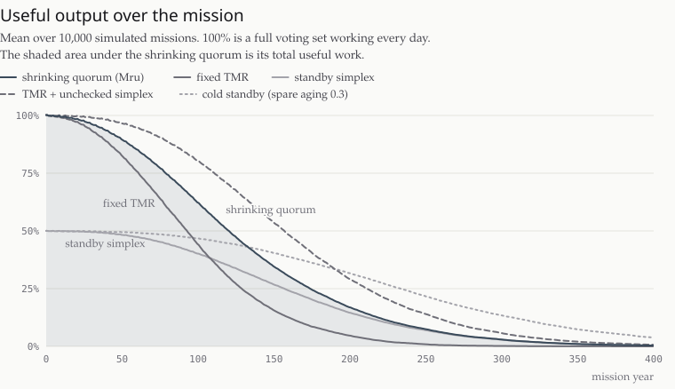
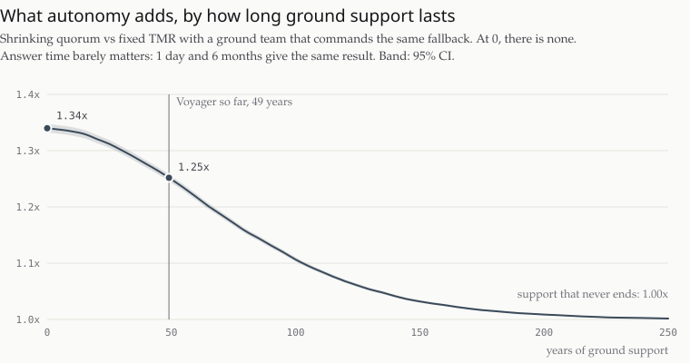
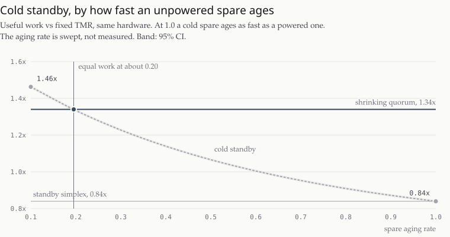
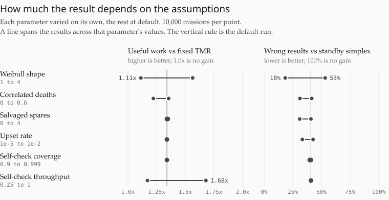

<p align="center">
  <a href="https://mru.space">
    <picture>
      <source media="(prefers-color-scheme: dark)" srcset="https://mru.space/assets/readme/mru-github-dark.gif">
      
    </picture>
  </a>
</p>

# dusk

A Monte Carlo of redundancy policies on hardware that only ever decays. Part of
[Mru](https://mru.space).

Classic triple modular redundancy [[1]](#references)[[2]](#references)[[3]](#references) has a fixed threshold. Three processors vote,
two can still detect a disagreement, and one cannot outvote anything, so the
system stops. On a mission with no repairs and no ground team in reach, that
throws away the last processor's whole remaining life.

The Mru whitepaper [[4]](#references) proposes a **shrinking quorum** instead: vote while
three processors are alive, compare while two are, and self-check on one.
Falling back from TMR to simplex is not new. The question here is what it
is worth when no ground team can command it. This program asks what that buys
and what it costs, on the same simulated hardware, against four baselines.

**Interactive version: [dusk.mru.space](https://dusk.mru.space)**

## Results

<picture>
  <source media="(prefers-color-scheme: dark)" srcset="docs/output-dark.svg">
  
</picture>

The shrinking quorum matches fixed TMR while three processors survive. It
pulls ahead as TMR starts to stop, and it keeps working long after. The shaded
area is the number that matters: total useful work across the whole decline.
The two dashed lines are the baselines in [Two more baselines](#two-more-baselines).

Default parameters, 10,000 missions, seed 1 (`cargo run --release`):

<!-- output: default -->
```
10000 missions, seed 1, horizon 1000 years
3 processors + 0 spares; Weibull shape 1.5, scale 125 y; p_corr 0.1; p_upset 1e-3/node-day; coverage 0.99; self-check throughput 0.5

policy                     useful      p10      p50      p90      service   wrong days     risk
                           mean y                                  mean y   mean / run   P(>=1)
fixed TMR                    99.0     37.6     92.7    168.9         99.0        0.000     0.0%
standby simplex              83.1     38.4     78.3    134.0        166.4        0.603    43.2%
shrinking quorum            132.6     64.3    126.6    208.3        166.4        0.246    20.1%
TMR + unchecked simplex     166.2     76.9    156.7    267.9        166.4       24.715    87.2%
cold standby, aging 0.1     144.7     69.7    139.3    226.7        289.8        1.043    61.3%
cold standby, aging 1.0      83.1     38.4     78.3    134.0        166.4        0.603    43.2%

risk: share of missions with at least one wrong result (95% CI)
  fixed TMR                0.0% to 0.0%
  standby simplex          42.2% to 44.2%
  shrinking quorum         19.3% to 20.9%
  TMR + unchecked simplex  86.6% to 87.8%
  cold standby, aging 0.1  60.4% to 62.3%
  cold standby, aging 1.0  42.2% to 44.2%
break-even: fixed TMR comes out ahead only if one wrong result costs more than 136 years of useful work (95% CI 131 to 142)

shrinking quorum vs fixed TMR: 1.34x the useful work in total (95% CI 1.33x to 1.35x); per mission median 1.27x (p10 1.00x, p90 2.33x)
shrinking quorum vs standby simplex: 160% of the useful work, 41% of the wrong results (95% CI 40% to 42%)
shrinking quorum vs TMR + unchecked simplex: 80% of the useful work, 1.00% of the wrong results (95% CI 0.96% to 1.04%)
shrinking quorum vs cold standby: 0.92x the useful work at spare aging 0.1 (95% CI 0.91x to 0.92x), 1.60x at spare aging 1.0 (95% CI 1.59x to 1.60x)
```

- **Against fixed TMR:** 1.34x the useful work (95% CI 1.33x to 1.35x). This
  assumes no ground support after launch. If ground support never ends, the
  gain falls to 1.00x (see [When the ground can help](#when-the-ground-can-help)).
  The shrinking quorum never does less on any single mission. That is true by
  construction, because the two policies are identical until TMR stops, and a
  unit test checks it over 200 seeds. The cost is a small number of wrong
  results in the single-processor tail, which TMR never lives long enough to
  produce.
- **Risk:** under the shrinking quorum, 20.1% of missions (95% CI 19.3% to
  20.9%) deliver at least one wrong result. Fixed TMR: 0.0%. Standby simplex:
  43.2% (95% CI 42.2% to 44.2%).
- **The price of those wrong results:** TMR comes out ahead only if one wrong
  result costs more than **136 years** of useful work (95% CI 131 to 142).
- **Against standby simplex:** the same service life, 160% of the useful work,
  and 59% fewer wrong results (95% CI 58% to 60%), because it votes for as long
  as it has hardware to vote with.

Intervals are from a paired bootstrap [[11]](#references): 2,000 resamples of whole missions.

### When the ground can help

Real spacecraft do not run TMR alone. When a string fails, a ground team
diagnoses it and commands a fallback by hand. Voyager, launched in 1977, still
has that team: it now switches off instruments to live within a power supply
that falls about 4 watts a year [[5]](#references). Interstellar Probe is designed to last
at least 50 years [[6]](#references). `--ground` adds that baseline:
TMR that, once it loses its majority, is switched to self-checking simplex by
the ground after some delay, as long as ground support still exists.

<picture>
  <source media="(prefers-color-scheme: dark)" srcset="docs/ground-dark.svg">
  
</picture>

<!-- output: ground -->
```
10000 missions, seed 1; shrinking quorum's useful work vs TMR + ground fallback

ground support ends        1 day   30 days  180 days   95% CI at 30 days
at launch                  1.34x     1.34x     1.34x   1.33x to 1.35x
after 10 years             1.33x     1.33x     1.33x   1.33x to 1.34x
after 25 years             1.31x     1.31x     1.31x   1.30x to 1.32x
after 50 years             1.25x     1.25x     1.25x   1.24x to 1.25x
after 100 years            1.11x     1.11x     1.11x   1.10x to 1.11x
after 200 years            1.01x     1.01x     1.01x   1.01x to 1.01x
never                      1.00x     1.00x     1.00x   1.00x to 1.00x
```

- **Answer time barely matters.** A fallback 1 day or 6 months after it is
  needed gives the same result to two decimals. The lost days are small next
  to decades of single-processor life.
- **What matters is whether anyone is still there.** With ground support that
  never ends, autonomy adds nothing to throughput: the ground does the same
  thing by hand. The whole gain comes from the years after support ends. With
  49 years of support (Voyager's so far) against a 98-year median hardware
  life, it is still 1.25x.

These years are relative to the hardware: with a 125-year Weibull scale, the
median processor lives about 98 years. Shorter-lived hardware moves the curve
left: with `--scale-years 60`, 50 years of support leaves a gain of 1.10x
instead of 1.25x.

### Two more baselines

Each one isolates a different design choice.

**TMR + unchecked simplex** isolates the value of self-check. It falls back on
its own, as the shrinking quorum does, but its last processor does not check
itself. It runs at full rate on one processor, and every upset there is a wrong
result. The shrinking quorum does 80% of its useful work and makes 1.00% of its
wrong results (95% CI 0.96% to 1.04%). Under the unchecked fallback, 87.2% of
missions (95% CI 86.6% to 87.8%) deliver at least one wrong result.

**Cold standby** is the nearest model here of dual-string with autonomous
switchover. One processor is powered and the others are not. When the active
one dies, the next is switched on in index order, and the active one
self-checks, as in standby simplex. Here it has three strings, on the same
hardware as TMR. An unpowered spare ages more slowly than a powered one, but
the rate is not known, so it is swept. A rate of 1.0 means a cold spare ages
as fast as a powered one, which makes cold standby the same as standby simplex.

<picture>
  <source media="(prefers-color-scheme: dark)" srcset="docs/cold-aging-dark.svg">
  
</picture>

From `cargo run --release -- --sweep`:

<!-- excerpt: sweep -->
```
cold standby by spare aging rate (1.0: a cold spare ages as fast as a powered one)

aging    useful  service  wrong/mission    risk   work vs TMR (95% CI)     vs shrinking quorum (95% CI)
         mean y   mean y
0.1       144.7    289.8          1.043   61.3%   1.46x (1.45x to 1.47x)   1.09x (1.09x to 1.10x)
0.2       132.0    264.3          0.958   58.5%   1.33x (1.33x to 1.34x)   1.00x (0.99x to 1.00x)
0.3       121.5    243.2          0.879   55.5%   1.23x (1.22x to 1.24x)   0.92x (0.91x to 0.92x)
0.4       112.8    225.7          0.812   52.6%   1.14x (1.13x to 1.15x)   0.85x (0.85x to 0.85x)
0.5       105.5    211.2          0.763   50.6%   1.07x (1.06x to 1.07x)   0.80x (0.79x to 0.80x)
0.6        99.4    199.0          0.718   48.7%   1.00x (1.00x to 1.01x)   0.75x (0.75x to 0.75x)
0.7        94.3    188.8          0.681   47.1%   0.95x (0.95x to 0.96x)   0.71x (0.71x to 0.71x)
0.8        90.0    180.1          0.652   45.7%   0.91x (0.90x to 0.92x)   0.68x (0.68x to 0.68x)
0.9        86.3    172.7          0.624   44.2%   0.87x (0.86x to 0.88x)   0.65x (0.65x to 0.65x)
1.0        83.1    166.4          0.603   43.2%   0.84x (0.83x to 0.85x)   0.63x (0.62x to 0.63x)

cold standby outworks the shrinking quorum below a spare aging rate of about 0.20
```

- **Where the shrinking quorum loses on work.** The unchecked fallback always
  does more useful work, at about 100 times the wrong results. Cold standby
  with three strings does more useful work if a cold spare ages at less than
  about 0.20 of the powered rate: the shrinking quorum does 0.92x its work at
  0.1 (95% CI 0.91x to 0.92x). Near 0.2 the two are even.
- **Where it wins.** Above an aging rate of about 0.2, the shrinking quorum
  does more useful work than cold standby, up to 1.60x at 1.0 (95% CI 1.59x to
  1.60x). At every aging rate, cold standby has more missions with a wrong
  result: 61.3% at 0.1 (95% CI 60.4% to 62.3%) and 43.2% at 1.0 (95% CI 42.2% to
  44.2%), against 20.1% for the shrinking quorum. It never votes, so nothing
  masks its upsets.
- **With two strings.** With `--nodes 2`, the true two-string case, the
  shrinking quorum does 1.05x the useful work of cold standby at spare aging
  0.1 (95% CI 1.05x to 1.05x) and 1.49x at 1.0 (95% CI 1.48x to 1.50x). At low
  aging rates that gain is small.

<picture>
  <source media="(prefers-color-scheme: dark)" srcset="docs/sensitivity-dark.svg">
  
</picture>

`--sweep` varies each parameter the model cannot pin down. Across every row,
the shrinking quorum returned **1.11x to 1.68x** the useful work of fixed TMR
and **47% to 82% fewer** wrong results than standby simplex. The work gain is
largest with early, random failures (Weibull shape 1) and smallest with sharp
wear-out (shape 4), where all three processors tend to die close together and
there is little tail left to use. Against cold standby, self-check throughput
moves the result most: at a throughput of 1, the shrinking quorum does 0.57x
the work of cold standby at spare aging 0.1, and 1.00x at 1.0.

<details>
<summary>Full sweep output (the numbers behind the charts)</summary>

<!-- output: sweep -->
```
10000 missions per row, seed 1; unlisted parameters at their defaults

varied                        work vs TMR  wrong/mission wrong vs simplex   work vs cold 0.1   work vs cold 1.0
shape 1                             1.56x          0.399            53%              0.96x              1.47x
shape 1.5                           1.34x          0.246            41%              0.92x              1.60x
shape 2.5                           1.19x          0.151            28%              0.87x              1.73x
shape 4                             1.11x          0.091            18%              0.84x              1.82x
p_corr 0                            1.35x          0.267            42%              0.93x              1.58x
p_corr 0.1                          1.34x          0.246            41%              0.92x              1.60x
p_corr 0.3                          1.30x          0.201            38%              0.90x              1.62x
p_corr 0.6                          1.22x          0.123            31%              0.84x              1.69x
spares 0                            1.34x          0.246            41%              0.92x              1.60x
spares 1                            1.35x          0.231            37%              0.90x              1.63x
spares 2                            1.35x          0.223            34%              0.89x              1.66x
spares 4                            1.34x          0.216            31%              0.86x              1.70x
p_upset 1e-5                        1.34x          0.002            33%              0.92x              1.60x
p_upset 1e-4                        1.34x          0.026            43%              0.92x              1.60x
p_upset 1e-3                        1.34x          0.246            41%              0.92x              1.60x
p_upset 1e-2                        1.34x          2.461            41%              0.92x              1.60x
coverage 0.9                        1.34x          2.489            41%              0.92x              1.60x
coverage 0.99                       1.34x          0.246            41%              0.92x              1.60x
coverage 0.999                      1.34x          0.025            40%              0.92x              1.60x
self-check throughput 0.25          1.17x          0.246            41%              1.60x              2.79x
self-check throughput 0.5           1.34x          0.246            41%              0.92x              1.60x
self-check throughput 1             1.68x          0.246            41%              0.57x              1.00x

cold standby by spare aging rate (1.0: a cold spare ages as fast as a powered one)

aging    useful  service  wrong/mission    risk   work vs TMR (95% CI)     vs shrinking quorum (95% CI)
         mean y   mean y
0.1       144.7    289.8          1.043   61.3%   1.46x (1.45x to 1.47x)   1.09x (1.09x to 1.10x)
0.2       132.0    264.3          0.958   58.5%   1.33x (1.33x to 1.34x)   1.00x (0.99x to 1.00x)
0.3       121.5    243.2          0.879   55.5%   1.23x (1.22x to 1.24x)   0.92x (0.91x to 0.92x)
0.4       112.8    225.7          0.812   52.6%   1.14x (1.13x to 1.15x)   0.85x (0.85x to 0.85x)
0.5       105.5    211.2          0.763   50.6%   1.07x (1.06x to 1.07x)   0.80x (0.79x to 0.80x)
0.6        99.4    199.0          0.718   48.7%   1.00x (1.00x to 1.01x)   0.75x (0.75x to 0.75x)
0.7        94.3    188.8          0.681   47.1%   0.95x (0.95x to 0.96x)   0.71x (0.71x to 0.71x)
0.8        90.0    180.1          0.652   45.7%   0.91x (0.90x to 0.92x)   0.68x (0.68x to 0.68x)
0.9        86.3    172.7          0.624   44.2%   0.87x (0.86x to 0.88x)   0.65x (0.65x to 0.65x)
1.0        83.1    166.4          0.603   43.2%   0.84x (0.83x to 0.85x)   0.63x (0.62x to 0.63x)

cold standby outworks the shrinking quorum below a spare aging rate of about 0.20
```

At `p_upset 1e-5` there are only about 20 wrong results across all 10,000
missions, so the 33% in that row is noisy. Treat it as a rough figure.

</details>

## Running it

```sh
cargo run --release                 # the default scenario
cargo run --release -- --spares 2   # add salvaged processors
cargo run --release -- --nodes 2    # two strings
cargo run --release -- --cold-aging 0.5  # cold standby at one spare aging rate
cargo run --release -- --sweep      # sensitivity, and cold standby by aging rate
cargo run --release -- --ground     # against TMR with a ground team
cargo run --release -- --ground --scale-years 60  # the same, shorter-lived hardware
cargo run --release -- --help       # every option
cargo run --release --bin charts    # redraw the charts and docs/data.json
cargo test --release
./scripts/check-readme.sh           # the README quotes docs/data.json
./scripts/check-readme.sh --run     # the README blocks match a fresh run
```

No dependencies. On a 10-core Apple M4 laptop the default run takes about 4
seconds, `--ground` about 13, and `--sweep` and `charts` about 2 minutes each.
Results depend only on the seed, never on the thread count.

Without `--cold-aging`, the report shows cold standby at both ends of the
aging range, 0.1 and 1.0, so that no single guess reads as the result. The
timeline chart uses the default of 0.3 and says so in its legend.

The charts are plain SVG, written by `src/bin/charts.rs` from the same seeds as
the tables above, in a light and a dark version styled after
[mru.space](https://mru.space). Nothing is drawn by hand. Curves are monotone
cubics [[12]](#references), which cannot overshoot the data.

The page at [dusk.mru.space](https://dusk.mru.space) is `docs/index.html`,
served by GitHub Pages. It draws the same charts live from `docs/data.json`,
which `charts` also writes. `data.json` has a `generated` block (date, commit,
host, Rust version, seed, runs) and a `display` block: the exact strings this
README quotes, made with the same format code as the command line.
`scripts/check-readme.sh` fails if the README is missing any of them, and
`--run` also reruns `dusk` and diffs the output blocks above. CI runs both
checks, with `cargo fmt`, `cargo clippy` and the tests.

## The model

Each mission is a day-by-day fault-injection run [[7]](#references).

**Processors die** on a Weibull lifetime [[8]](#references). Shape 1.5 and a 125-year scale give
a median life of about 98 years.

**Deaths can be correlated** [[9]](#references). With probability `p_corr`, a death also kills one
other processor in service that day, and that death can do the same. This is a
stand-in for a shared thermal or power fault, or one particle shower hitting
neighbors.

**Spares are salvaged.** With `--spares N`, N more processors belong to
instruments. Each joins the pool when its instrument dies, but it has aged in
the same radiation since launch, so it can die before it is ever used. Both
TMR and the shrinking quorum use spares; simplex swaps them in as standbys,
and cold standby keeps them unpowered once they join.

**Upsets corrupt a day's result.** Each processor, each day, has a `p_upset`
chance of a transient fault that gets past EDAC and scrubbing. That is far
rarer than the raw bit-flip rate, and it is the number that matters here.

**The policies:**

| Live processors | Fixed TMR | Standby simplex | Shrinking quorum | TMR + unchecked simplex | Cold standby |
|---|---|---|---|---|---|
| 3 or more | vote, masks one upset | one self-checks | vote, masks one upset | vote, masks one upset | one self-checks, the rest unpowered |
| 2 | compare, loses the day on any upset | one self-checks | compare, loses the day on any upset | compare, loses the day on any upset | one self-checks, one unpowered |
| 1 | **stops for good** | self-checks | self-checks | full rate, no check | self-checks |

TMR + ground fallback behaves like fixed TMR, except that on one processor it
idles until the ground's command arrives and then self-checks. If support has
already ended when TMR loses its majority, no command comes and it stops.

A self-checking processor catches a fraction `coverage` of its upsets and loses
those days. The rest become **wrong results** (undetected errors): output nobody knew was bad. It
also runs at `selfcheck_throughput` of full rate, because checking yourself
means doing the work twice.

**A cold spare ages on a slower clock.** Each processor has a wear life: its
own Weibull draw, before any correlated death. Cold standby reads it as an
age. A processor ages at full rate until it joins (a salvaged spare sits
powered in its instrument), at `--cold-aging` of that rate while it waits
unpowered, and at full rate once it is switched on. It dies on the first day
its age reaches its wear life, so it can die on the shelf. Correlated deaths
keep the victim and killer of the powered run: the victim dies on the day its
killer dies on the cold timeline, if that is sooner and it has joined by then.
This adds no random draws, so every other policy's numbers stay the same.

**Useful work** is days of correct output, weighted by throughput and summed
over the whole mission: the accomplishment measure performability analysis
uses for systems that degrade [[10]](#references).

**The comparison is paired.** Every policy runs against the same fault history
and the same upsets, drawn from keyed hashes rather than a shared stream. Any
difference between policies is the policy.

### Definitions

These are what the code computes (`Outcome` in `src/model.rs`, the report in
`src/main.rs`).

- **Useful:** the sum over mission days of the throughput credit for a correct
  delivered result. A vote day with at most one upset among its three
  processors: 1.0. A pair day with no upset: 1.0. A self-checking lone
  processor with no upset: `selfcheck_throughput` (0.5). An unchecked lone
  processor with no upset: 1.0. Lost, wrong and idle days: 0. The tables show
  the mean over missions, in years of 365.25 days. p10, p50 and p90 are
  percentiles over missions: the value at position round(p * (n - 1)) of the n
  missions sorted by useful work, counting from 0.
- **Service:** from launch to the first day the policy can never produce
  output again, or to the horizon. Fixed TMR: the first day with fewer than two
  live processors. The others: the first day with none (TMR + ground fallback
  also ends on the day it loses its majority, if support has already ended).
  Lost, wrong and idle days count as service.
- **Wrong days:** days whose delivered result an upset corrupted and nothing
  caught. One day is one result. Only a lone processor makes one: a
  self-checking one whose check misses the upset, or an unchecked one with any
  upset. A vote or a pair never does, by construction: two or more upsets in a
  vote count as a caught split. This flatters every voting policy equally.
- **Lost days:** results that were caught as bad and thrown away. The code
  counts them but does not print them. Every day of service is exactly one of
  correct, lost or wrong, or idle while TMR + ground fallback waits.
- **Risk:** the share of missions with at least one wrong day.
- **Break-even:** `(useful_A - useful_B) / (wrong_A - wrong_B) / 365.25`, with
  each total summed over all missions. A is the shrinking quorum and B is fixed
  TMR.

## Checked against the real code

`dusk --bench FILE` replays the bench of
[mruspace/flight](https://github.com/mruspace/flight) through the model. The
bench runs the real `quorum` code on three processes, kills replicas at fixed
ticks and injects upsets at a fixed rate. The check gives the model the same
deaths, the same upset rate and the same self-check coverage, one tick as one
day, and compares the mean correct and wrong results.

```sh
cargo run --release -- --bench ../flight/bench/results/2026-10-11-darwin-arm64.csv
```

On the published Apple M4 results (10 seeds per row), 17 of 18 rows agree
within 3 standard errors on both correct and wrong results. The 18th, the
shrinking quorum's correct results with two replicas lost early at an upset
rate of 0.01, is 3.4 standard errors low. Its two phases, rerun over 200 seeds,
matched the model: 40.38 results lost against 40.42 expected with two
replicas, and 19.17 caught and 0.90 wrong against 19.00 and 1.00 with one.

The bench covers fixed TMR and the shrinking quorum only. Any other policy in
a bench file is skipped with a note. The two newer baselines, TMR + unchecked
simplex and cold standby, are checked by unit tests only.

This checks the **policy model** against the code. It does not calibrate the
**environment**: the bench sets the upset rate and the failure times itself,
so it cannot measure them. Those need radiation test or flight data. The bench
also has faults the model does not: a replica that is stuck on a wrong value.
On one replica, such a fault gives wrong results until the next known-answer
test. The model has only processors that die.

## What this does not claim

The parameters are **illustrative, not calibrated.** They are plausible
orders of magnitude, not values fitted to flight data or radiation test
results. That is why the sweep exists: the claim is the shape of the trade,
and the sweep shows where it holds.

Other simplifications:

- A day is the unit of work. Nothing inside a day is modeled.
- Two or more upsets in a vote are always caught as a split. A real voter can
  be fooled by identical wrong answers, so this slightly flatters every voting
  policy equally.
- Power, thermal limits, and duty cycling are not modeled. Every processor
  runs every day, except a cold spare.
- The ground team in `--ground` is perfect: it always diagnoses correctly and
  its command always works. Real anomaly response is slower and less certain,
  so this baseline flatters the ground.
- The cold spare aging rate is a sweep, not a measured value. No source here
  gives it for any part.
- Cold standby slightly under-correlates deaths. It keeps the victims of the
  powered run, so a spare that lives longer on the cold timeline is never
  picked as a new victim.

## Citing

```bibtex
@software{binns2026dusk,
  author = {Binns, Will},
  title  = {dusk: A Monte Carlo of Redundancy Policies on Hardware That Only Ever Decays},
  year   = {2026},
  url    = {https://github.com/mruspace/dusk},
  note   = {Results at https://dusk.mru.space}
}
```

GitHub's "Cite this repository" button reads the same from `CITATION.cff`.

## References

1. R. E. Lyons and W. Vanderkulk, "The Use of Triple-Modular Redundancy to Improve Computer Reliability," *IBM Journal of Research and Development*, vol. 6, no. 2, pp. 200–209, 1962.
2. J. von Neumann, "Probabilistic Logics and the Synthesis of Reliable Organisms from Unreliable Components," in *Automata Studies*, C. E. Shannon and J. McCarthy, Eds. Princeton University Press, 1956, pp. 43–98.
3. D. P. Siewiorek and R. S. Swarz, *Reliable Computer Systems: Design and Evaluation*, 3rd ed. A K Peters, 1998.
4. W. Binns, "Mru: A Fault-Tolerant Operating System for Thousand-Year Autonomous Operation," 2026. [doi:10.5281/zenodo.20579438](https://doi.org/10.5281/zenodo.20579438)
5. NASA Jet Propulsion Laboratory, "NASA Turns Off 2 Voyager Science Instruments to Extend Mission," March 5, 2025. [jpl.nasa.gov](https://www.jpl.nasa.gov/news/nasa-turns-off-two-voyager-science-instruments-to-extend-mission/)
6. P. C. Brandt, E. A. Provornikova, et al., "Interstellar Probe: Humanity's Exploration of the Galaxy Begins," *Acta Astronautica*, vol. 199, pp. 364–373, 2022. [doi:10.1016/j.actaastro.2022.07.011](https://doi.org/10.1016/j.actaastro.2022.07.011)
7. M.-C. Hsueh, T. K. Tsai, and R. K. Iyer, "Fault Injection Techniques and Tools," *Computer*, vol. 30, no. 4, pp. 75–82, 1997.
8. W. Weibull, "A Statistical Distribution Function of Wide Applicability," *Journal of Applied Mechanics*, vol. 18, no. 3, pp. 293–297, 1951.
9. A. Avižienis, J.-C. Laprie, B. Randell, and C. Landwehr, "Basic Concepts and Taxonomy of Dependable and Secure Computing," *IEEE Transactions on Dependable and Secure Computing*, vol. 1, no. 1, pp. 11–33, 2004.
10. J. F. Meyer, "On Evaluating the Performability of Degradable Computing Systems," *IEEE Transactions on Computers*, vol. C-29, no. 8, pp. 720–731, 1980.
11. B. Efron, "Bootstrap Methods: Another Look at the Jackknife," *The Annals of Statistics*, vol. 7, no. 1, pp. 1–26, 1979. [doi:10.1214/aos/1176344552](https://doi.org/10.1214/aos/1176344552)
12. F. N. Fritsch and R. E. Carlson, "Monotone Piecewise Cubic Interpolation," *SIAM Journal on Numerical Analysis*, vol. 17, no. 2, pp. 238–246, 1980. [doi:10.1137/0717021](https://doi.org/10.1137/0717021)

## Questions or contributions

Issues and PRs aren't open to the public on this repo, but we'd love to hear from
you. Email [contact@mru.space](mailto:contact@mru.space).

## License

Code under [Apache License 2.0](./LICENSE). The **Mru** name and mark are
trademarks; see [TRADEMARK.md](./TRADEMARK.md).
